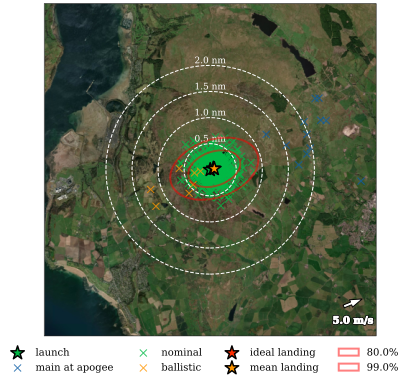

# Aerospace Toolbox

> Under active development. Please report any bugs and suggest any features/bug fixes. Changes may alter/break APIs

A collection of tools and scripts for the design and analysis of aerospace vehicles.

## Core

### Features

* Implements a wrapper around [xFoil](https://web.mit.edu/drela/Public/web/xfoil/) (2D Airfoil Aerodynamic Simulation Program) to predict the performance of airfoils programmatically and compare them efficiently.
* Implements the United States Standard Atmosphere 1976 based on the [ussa1976](https://pypi.org/project/ussa1976/) library with additional extensions and plotting to determine atmospheric properties up to 1000 km.

## Rocketry

### Features

* Supports 6-degree-of-freedom flight simulations using [rocketpy](https://docs.rocketpy.org/en/latest/index.html)
* Implements an extensible motor object model and supporting functions to support the creation of custom rocket motors and amending existing motors.
* Supports downloading rocket motor data from [thrustcurve.org](https://www.thrustcurve.org/) and importing into motor object model with efficient caching.
* Implements methods to select the optimal rocket motor for a rocket and determine the optimal fixed or variable thrust curve to maximise altitude within a specific impulse limit.
* Supports scripting [RASAero II](https://www.rasaero.com/) (Aerodynamic simulation software for rockets) with support for automatically estimating aerodynamic properties directly from a defined rocket object model, including efficient caching to improve running speed.
* Provides additional plotting and information from rocketpy simulation and automatic error handling.
* Supports simulating automatically with no separation/ejection events and all recovery devices deployed at apogee to determine probabilistic landing regions under failure.
* Provides a framework to support additional non-standard event simulation.
* Supports stochastic monte-carlo simulations using either default (reasonable first-order distributions) or user-defined distributions and plotting dispersion patterns on satellite maps with [MapBox](https://www.mapbox.com/).

### Usage

You can download this code yourself, run the included scripts and generate your own as follows,

0. Requires python3.12 and pip
1. Download the project. Press the "Code" button then "Download ZIP".
2. Extract the zip file in your working directory.
3. Install python requirements ```pip install -r requirements.txt```
4. Run the jupyter notebook scripts starting with [Flight Analysis.ipynb](Flight%20Analysis.ipynb) (all external files from xFoil and RASAero II have been pre-generated).

> xFoil and RASAero II may also be required depending on usage. If required this will be highlighted including with installation instructions within error messages.
> An MapBox account and access token is required to plot with satellite maps.

### Monte Carlo Simulations

#### Input Distributions

The monte carlo simulation supports fixed values, normal distributions and uniform distributions as inputs by default. If no input distribution is provided the default distributions below are used. Further/custom distributions are supported by extension.

```python
diameter = Normal(76 / 1000, std=1 / 1000)
heading = Uniform(0, 360)
inclination = Fixed(85)
```

The distribution of all design inputs, environmental and launch parameters can be varied along with the probability of experiencing different failures.

>Further documentation is available via docstrings and type hinting throughout the codebase.

#### Default Distributions

Please note these only apply where relevant and they have not be overwrite by specifying your own distribution.

| Variable | Default Distribution |
| - | - |
| Rocket | |
| Diameter | Normal(x̄=x, σ=0.4mm) |
| Mass without motor | Normal(x̄=x, σ=10g) |
| Inertia without motor | Normal(x̄=x, σ=4mm) per direction |
| Center of mass | Normal(x̄=x, σ=4mm) |
| Aero multiplier | Normal(x̄=x, σ=5%) |
| Rail Buttons | |
| Upper position | Normal(x̄=x, σ=4mm) |
| Lower position | Normal(x̄=x, σ=4mm) |
| Angular position | Normal(x̄=x, σ=10 deg) |
| Nose | |
| Length | Normal(x̄=x, σ=4mm) |
| Fins | |
| Root chord | Normal(x̄=x, σ=4mm) |
| Tip chord | Normal(x̄=x, σ=4mm) |
| Span | Normal(x̄=x, σ=4mm) |
| Position | Normal(x̄=x, σ=4mm) |
| Sweep length | Normal(x̄=x, σ=4mm) |
| Aero multiplier | Normal(x̄=x, σ=5%) |
| Tail | |
| Top diameter | Normal(x̄=x, σ=0.4mm) |
| Bottom Diameter | Normal(x̄=x, σ=0.4mm) |
| Length | Normal(x̄=x, σ=4mm) |
| Position | Normal(x̄=x, σ=4mm) |
| Parachute | |
| Drag coefficient | Normal(x̄=x, σ=0.05 * x) |
| Diameter | Normal(x̄=x, σ=0.4mm) |
| Motor delay | Normal(x̄=x, σ=0.4s) |
| Deploy altitude | Normal(x̄=x, σ=20m) |
| Motor | |
| Position | Normal(x̄=x, σ=4mm) |
| Thrust multiplier | Normal(x̄=x, σ=5%) |
| Time multiplier | Normal(x̄=x, σ=5%) |
| Mass multiplier | Normal(x̄=x, σ=5%) |
| Thrust Eccentricity | |
| Distance | Normal(x̄=x, σ=0.02 * diameter) |
| Direction | Uniform(0 - 360 deg) if 0 else Normal(x̄=x, σ=10 deg) |
| Aerodynamic Eccentricity | |
| Distance | Normal(x̄=x, σ=0.02 * diameter) |
| Direction | Uniform(0 - 360 deg) if 0 else Normal(x̄=x, σ=10 deg) |
| Launcher | |
| Length | Normal(x̄=x, σ=10mm) |
| Heading | Uniform(0 - 360 deg) if 0 else Normal(x̄=x, σ=10 deg) |
| Inclination | Normal(x̄=x, σ=2 deg) |
| Environment | |
| Latitude | Fixed(x=x) |
| Longitude | Fixed(x=x) |
| Elevation | Normal(x̄=x, σ=5m) |
| Wind u | Normal(x̄=x, σ=1 m/s) |
| Wind v | Normal(x̄=x, σ=1 m/s) |
| Wind speed | Normal(x̄=x, σ=√2 m/s) |
| Wing bearing | Normal(x̄=x, σ=10 deg) |

> [x] user input/design point

#### Configuring Plots

Dispersion plots can be configured from the plotting call to include: impact energies as a colour bar, satellite imagery, range rings in metres, kilometres and nautical miles, confidence/probability ellipsoids and differentiating between failure modes in flight.


